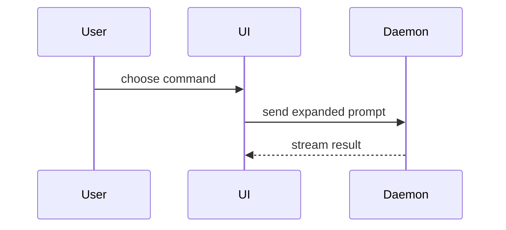

## Branch guard (before committing or opening a PR)

Author work never lands on `main`: a push to `main` is a merge, and the
`challenges` workflow treats it as one. If the author is on `main` — or a
detached HEAD — get them onto their own branch before the first commit.

1. `git branch --show-current`. Already off `main` → continue.
2. Branch name = the author's GitHub login: `gh api user --jq .login`. If
   `gh` is missing or unauthenticated, ask for the login; never guess and
   never use `git config user.name`.
3. `git fetch origin`, then switch:
   - local `<login>` exists → `git switch <login>`
   - only `origin/<login>` exists → `git switch --track origin/<login>`
   - neither exists → `git switch -c <login>`

   Uncommitted changes ride along. If the branch you land on is behind
   `origin/main`, `git merge origin/main` before adding work; if it has
   diverged from `origin/<login>`, stop and ask. Never force-push.
4. If local `main` is ahead of `origin/main` (commits already made), carry
   those commits onto `<login>` first (rebase/cherry-pick), verify they are
   on the branch, then `git branch -f main origin/main`. If `<login>` has
   divergent history, stop and ask — never force-push or reset away work.
5. Done when `git branch --show-current` prints `<login>` and
   `git log main..HEAD` holds the author's work. Commit there, never on
   `main`.

## Open the PR

Push the branch and open it against `main`:

```sh
git push -u origin <login>
gh pr create --base main --head <login> \
  --title "<title>" --body-file <body-file>
```

If a PR already exists for the branch (`gh pr view <login> --json number`),
update it with `gh pr edit <number> --body-file <body-file>` instead.
Never run `git push origin main`.

Use this template for writing the PR body:

```markdown
## Summary

<diagram, diff-sketch, or tree>

## Evidence

- **Before:** <screenshot/output/failing test run>
  **After:** <screenshot/output/passing test run>

## Merge Danger

**Door:** <one-way or two-way>

<optional: description>

**Blast Radius:** <one-word description>

<optional: potential ramifications of merge>
```

## Sections

Skip all preambles and keep prose brief. Use the user's domain language from `GLOSSARY.md`.

### Summary

Pick the smallest view that makes the key point clear.

- Show logic or an algorithm as pseudocode:

```text
on(save)
  if content is unchanged
    return cached result
  write new content
  return fresh result
```

- Show runtime control flow as a call tree:

```text
submitForm
  createSession
    persistPrompt
    launchAgent
  navigateToSession
```

- Show UI structure as a component tree, including state and module boundaries that matter:

```text
<SessionPage> (apps/example/src/routes/session.tsx)
  useSessionEvents()
  <SessionToolbar>
    <RunSkillButton> (packages/ui)
```

- Show file responsibility or a broad refactor as a shallow file tree:

```text
src/
├── commands/       # parses user actions
├── sessions/       # owns session state
└── transport/      # sends API requests
```

- Show component interaction, control flow, or data flow with Mermaid:



- Use `diff` when the point is what changes and the surrounding shape already exists. Match the diff shape to the topic.

For a component change:

```diff
 <SessionPage>
   useSessionEvents()
   <SessionToolbar>
+    <RunSkillButton />
   <SessionTimeline>
+    <SkillResultCard />
```

For a file-layout change:

```diff
 src/
 ├── commands/
+│   └── show-me.ts       # expands the slash command
 ├── sessions/
-└── transport.ts
+└── transport/
+    ├── client.ts
+    └── stream.ts
```

For a call-tree or call-stack change:

```diff
 submitForm
   createSession
     persistPrompt
+    expandSkillMention
     launchAgent
-  navigateToSession
+  navigateToSession
+    subscribeToEvents
```

For a state or control-flow change:

```diff
 on(save)
-  write content
+  if content is unchanged
+    return cached result
+  write new content
+  invalidate cache
```

- Show the whole block when most of it is new, when omitted context would hide ownership or order, or when the user needs a copyable target shape:

```ts
function expandSkill(command: string): string {
  const skillName = command.slice(1);
  return `use the ${skillName} skill`;
}
```

#### Guidance

Place each visual next to the short text it supports. Keep only the calls, files, props, states, and boundaries needed to answer the user's current question or the options to resolve the current discussion point.

You may use one of these, you may use several, it is unlikely you will use all of them. Use your judgement and don't overwhelm the user.

### Evidence

Concrete evidence that the change works. Show a before and after.

Screenshots are S-tier - when the environment is set up for it and the change is visual.

Execution-based evidence is A-tier. Test results, console output. Show the exact test that now fails and passes, using pseudocode.

### Merge Danger

Describe whether it's a one-way or two-way door. You can walk back through two-way doors, but not one-way doors. A PR that is cheap to roll back is lower risk. Changes that involve destructive actions or hard-to-reverse decisions are one-way doors.

The blast radius is the potential impact or scope of the changes introduced by this PR. Consider all possibilities. Examples are layout shift, breakages for consumers, mobile responsiveness, etc.
